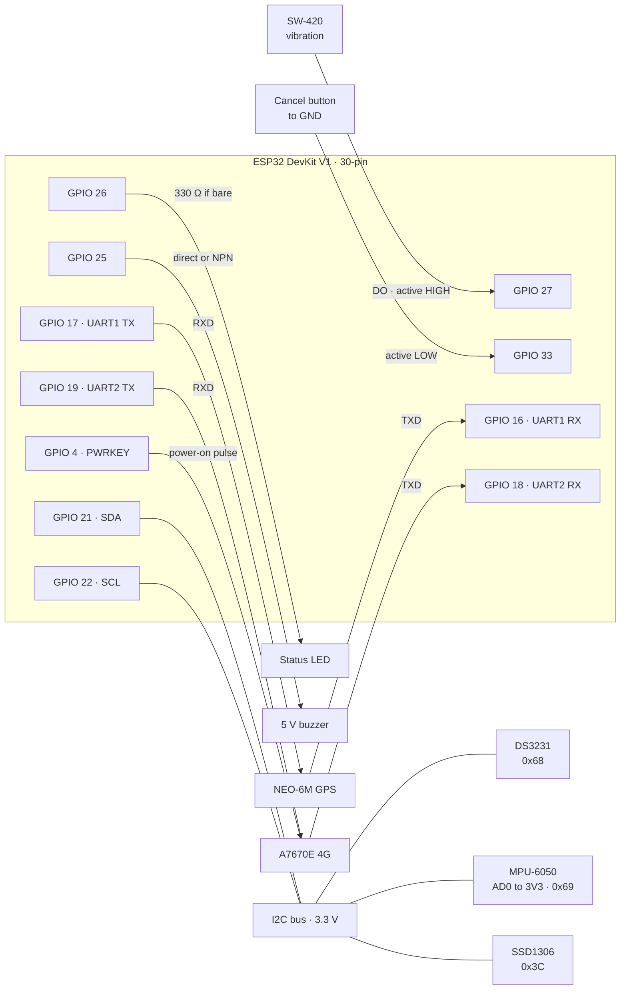
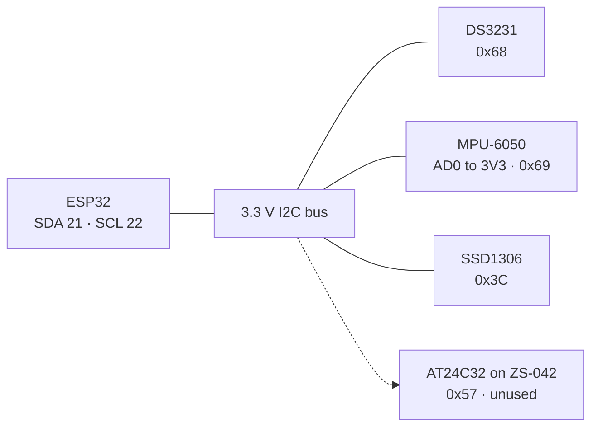
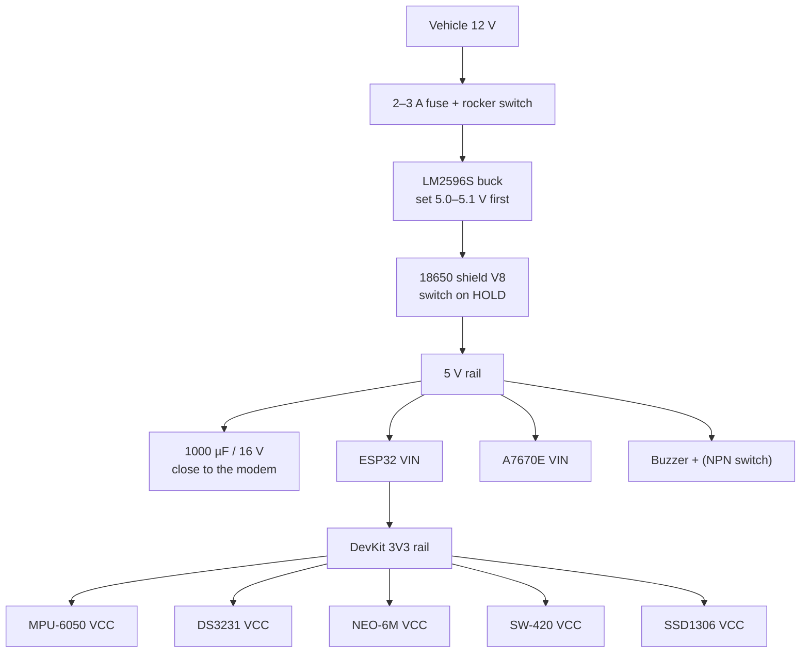

# Optimal wiring diagram

Visual companion to [`wiring.md`](wiring.md). It shows the current recommended
build: ESP32 DevKit V1, the shared I2C bus with the DS3231 at `0x68` and the
MPU-6050 moved to `0x69`, both UARTs, and the 5 V / 3.3 V power chain.

> **Source of truth:** [`firmware/include/pins.h`](../firmware/include/pins.h)
> and the pin table in [`wiring.md`](wiring.md). If this page and the table
> disagree, the table wins and this page is the bug.

> **Firmware note:** this is the RTC build (develop, after #160). The v0.4.1
> firmware still expects the MPU at `0x68`; do not flash it on a board wired to
> this diagram.

## System diagram



Every arrow is a single wire. UART arrows are crossed on purpose: the GPS and
modem transmit pins go to ESP32 RX, and ESP32 TX goes to their receive pins.

## Header map

The DevKit V1 has 15 pins per side. Used pins are marked; everything else is
spare and must not be reassigned without changing `pins.h` and `wiring.md`.

```text
              USB connector
        ┌───────────────────────┐
   EN   │                       │ 3V3  → DS3231, MPU, GPS, SW-420, OLED
   36   │                       │ GND
   39   │                       │ 15   · strapping, do not use
   34   │   ESP32 DevKit V1     │ 2    · strapping, do not use
   35   │   ESP32-WROOM-32      │ 4    → A7670E PWRKEY (optional)
   32   │   30-pin              │ 16   ← GPS TXD
   33   │                       │ 17   → GPS RXD
   25   │                       │ 5    · strapping, do not use
   26   │                       │ 18   ← A7670E TXD
   27   │                       │ 19   → A7670E RXD
   14   │                       │ 21   ↔ SDA
   12   │                       │ 3    · RX0, spare
   13   │                       │ 1    · TX0, USB serial
  GND   │                       │ 22   ↔ SCL
  VIN   │ 5 V rail              │ 23   ← MPU INT (optional)
        └───────────────────────┘
```

| Left pin | Use | Right pin | Use |
| --- | --- | --- | --- |
| EN | reset, leave free | 3V3 | sensor rail |
| 36 / 39 | spare, input-only | GND | common ground |
| 34 | battery sense (optional) | 15 | **do not use** |
| 35 | ignition sense (optional) | 2 | **do not use** |
| 32 | spare | 4 | modem PWRKEY |
| 33 | cancel button | 16 | GPS RX |
| 25 | buzzer | 17 | GPS TX |
| 26 | status LED | 5 | **do not use** |
| 27 | SW-420 DO | 18 | modem RX |
| 14 | factory reset (optional) | 19 | modem TX |
| 12 | **do not use** | 21 | SDA |
| 13 | WiFi reset (optional) | 3 | spare |
| GND | common ground | 1 | USB serial |
| VIN | 5 V rail | 22 | SCL |
| | | 23 | MPU INT (optional) |

GPIO 0 and 2 are also strapping pins; they are not used by the tracker.

## I2C bus



| Device | Address | VCC | Notes |
| --- | --- | --- | --- |
| DS3231 RTC | `0x68` | 3V3 | CR2032 backup; 32K, SQW and INT stay unconnected |
| MPU-6050 | `0x69` | 3V3 | **AD0 to 3V3**; with AD0 low it collides with the RTC at `0x68` |
| SSD1306 | `0x3C` | 3V3 | never 5 V; no reset line |
| AT24C32 | `0x57` | 3V3 | present on many RTC boards, unused by the firmware |

The modules each carry I2C pull-ups, so the bus ends up with several in
parallel. That is fine at 100 kHz and for the display's 400 kHz bursts. Do not
add external pull-ups.

## Power chain



The A7670E draws amp-scale bursts on transmit. The 1000 µF capacitor is the
buffer for those bursts; mount it next to the modem with the striped leg to
GND. All grounds are common.

## Module connections

| Module | Module pin | Connects to | Notes |
| --- | --- | --- | --- |
| DS3231 | VCC, GND | 3V3, GND | never 5 V |
| DS3231 | SDA, SCL | GPIO 21, GPIO 22 | shared bus |
| DS3231 | 32K, SQW, INT | not connected | no ESP32 pin needed |
| MPU-6050 | VCC, GND | 3V3, GND | |
| MPU-6050 | SDA, SCL | GPIO 21, GPIO 22 | shared bus |
| MPU-6050 | AD0 | 3V3 | sets the address to `0x69` |
| MPU-6050 | INT | GPIO 23 | optional; firmware polls today |
| SSD1306 | VCC, GND | 3V3, GND | never 5 V |
| SSD1306 | SDA, SCL | GPIO 21, GPIO 22 | shared bus |
| NEO-6M | VCC, GND | 3V3, GND | |
| NEO-6M | TXD | GPIO 16 | ESP32 UART1 RX |
| NEO-6M | RXD | GPIO 17 | ESP32 UART1 TX |
| NEO-6M | PPS | not connected | optional |
| A7670E | VIN, GND | 5 V rail, GND | not the 3V3 rail |
| A7670E | TXD | GPIO 18 | ESP32 UART2 RX |
| A7670E | RXD | GPIO 19 | ESP32 UART2 TX |
| A7670E | PWRKEY | GPIO 4 | optional; firmware pulses it |
| SW-420 | VCC, GND | 3V3, GND | |
| SW-420 | DO | GPIO 27 | active HIGH, idles LOW |
| SW-420 | AO | not connected | |
| Cancel button | leg 1 | GPIO 33 | `INPUT_PULLUP` |
| Cancel button | leg 2 | GND | active LOW |
| Status LED | anode | GPIO 26, 330 Ω if bare | cathode to GND |
| Buzzer | + | 5 V | through NPN for a louder harness |
| Buzzer | − | GPIO 25 direct, or NPN collector | base 1 kΩ, emitter GND |
| WiFi reset | leg 1 | GPIO 13 | to GND, boot only, 5 s |
| Factory reset | leg 1 | GPIO 14 | to GND, boot only, 10 s |
| Battery sense | divider tap | GPIO 34 | input-only, divider required |
| Ignition sense | divider tap | GPIO 35 | input-only, divider required |

## Optimal routing

- Keep SDA/SCL short (under about 20 cm) and twisted with a GND return. Route
  them away from the buck and the modem antenna.
- Ground everything at one point near the shield's 5V OUT. Do not daisy-chain
  the modem ground through the sensors.
- Mount the MPU-6050 rigidly near the vehicle centre with its axes aligned to
  the chassis; mount the SW-420 on the same rigid surface so potholes and
  impacts are seen consistently.
- Keep the GPS antenna face-up with a clear view of the sky, at least a few
  centimetres from the modem antenna, and never under metal.
- Put the cancel button within the driver's reach and strain-relieve its cable.
- Fuse the 12 V input before the switch, and add reverse-polarity and TVS
  protection if the vehicle supply is noisy.
- Do not connect USB and the V8 5 V output to VIN at the same time unless the
  DevKit blocks backfeed.

## Pre-power check

- [ ] Buck measured at 5.0–5.1 V **before** the shield is connected.
- [ ] V8 switch on HOLD; cells matched and correctly polarised.
- [ ] 1000 µF across 5V OUT and GND, striped leg to GND, next to the modem.
- [ ] MPU AD0 to 3V3, never 5 V and never floating.
- [ ] DS3231 and OLED on 3V3, never 5 V.
- [ ] I2C scan shows `0x68`, `0x69` and, with the panel fitted, `0x3C`.
- [ ] Buzzer driver is NPN + 1 kΩ if the pin cannot drive the buzzer directly.
- [ ] All grounds common.

## Related documents

- [`wiring.md`](wiring.md) — canonical pin table and pre-power checklist.
- [`hardware.md`](hardware.md) — sensor notes, bench checklist and bill of materials.
- [`runbook.md`](runbook.md) — boot lines, provisioning and troubleshooting.
- [`safety.md`](safety.md) — crash, cancel and alert behavior.
